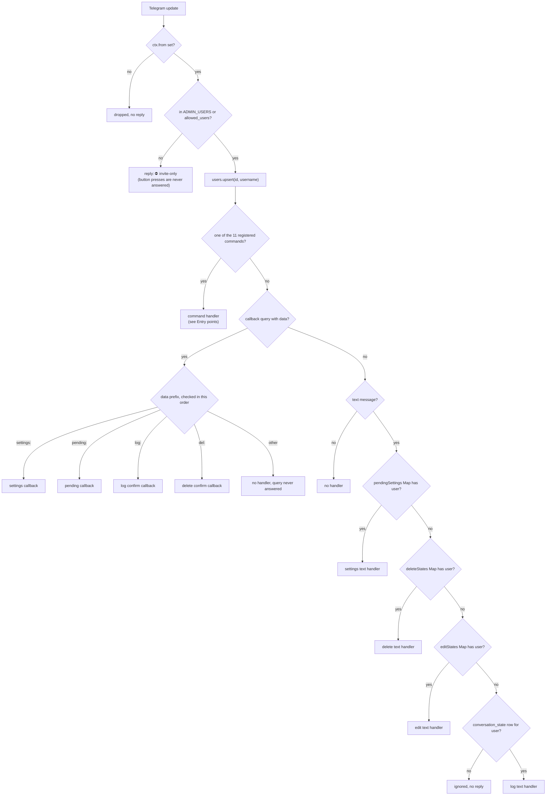
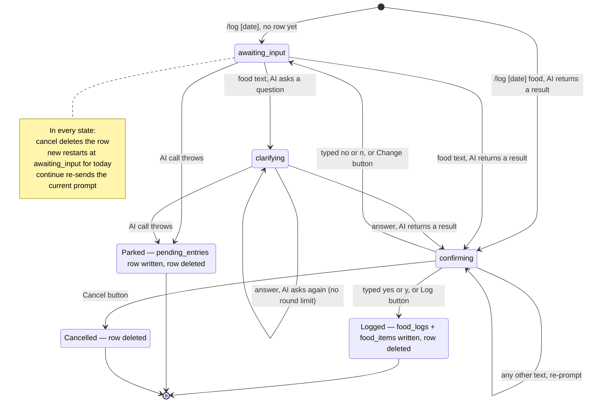
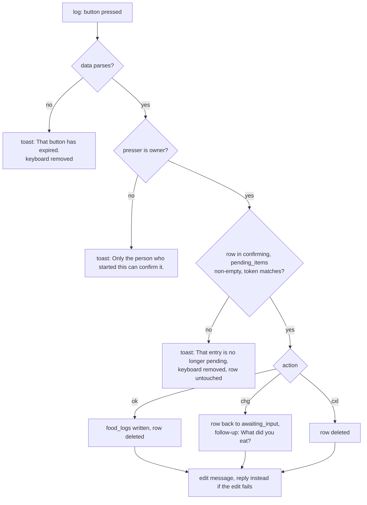
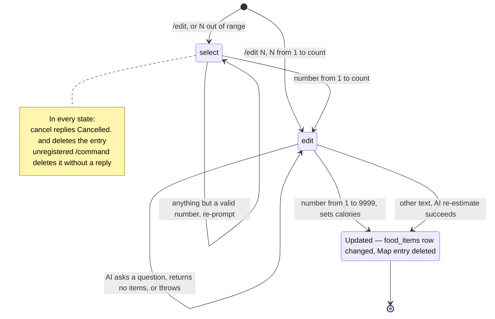
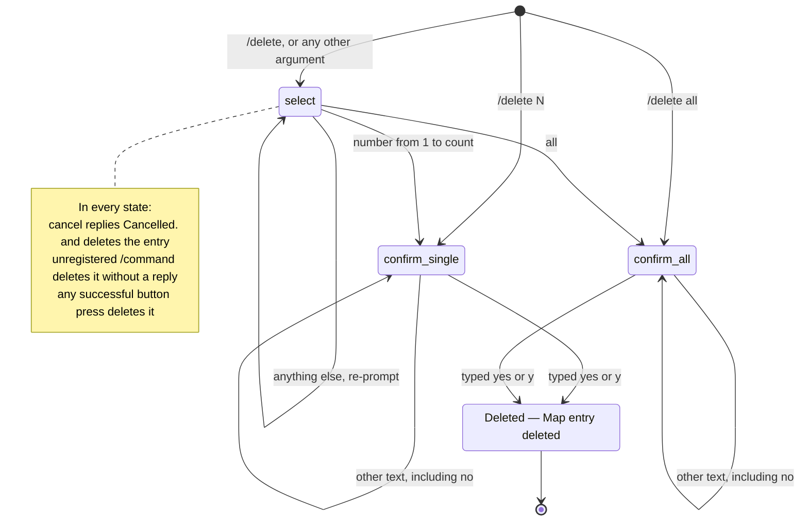
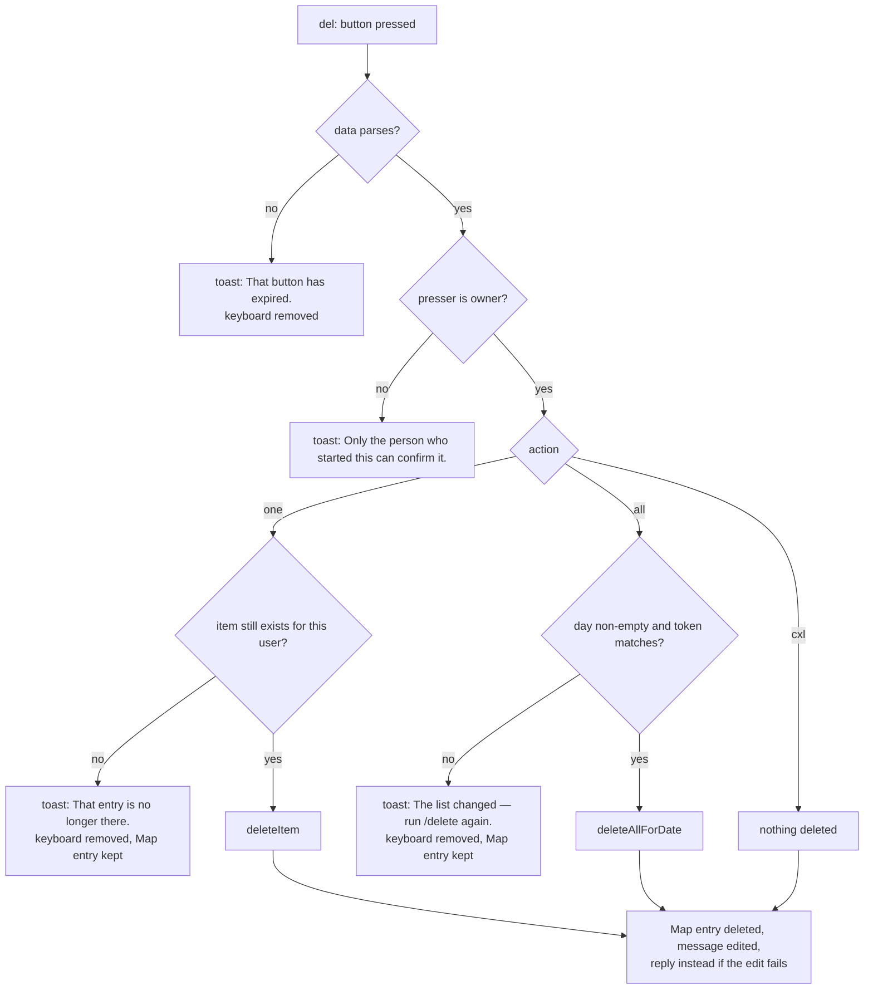
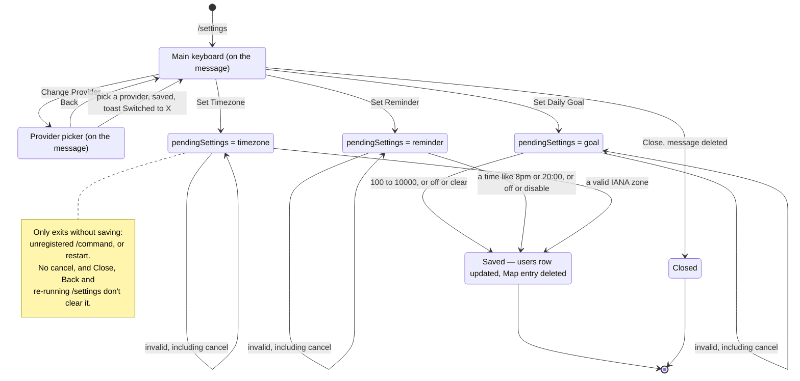
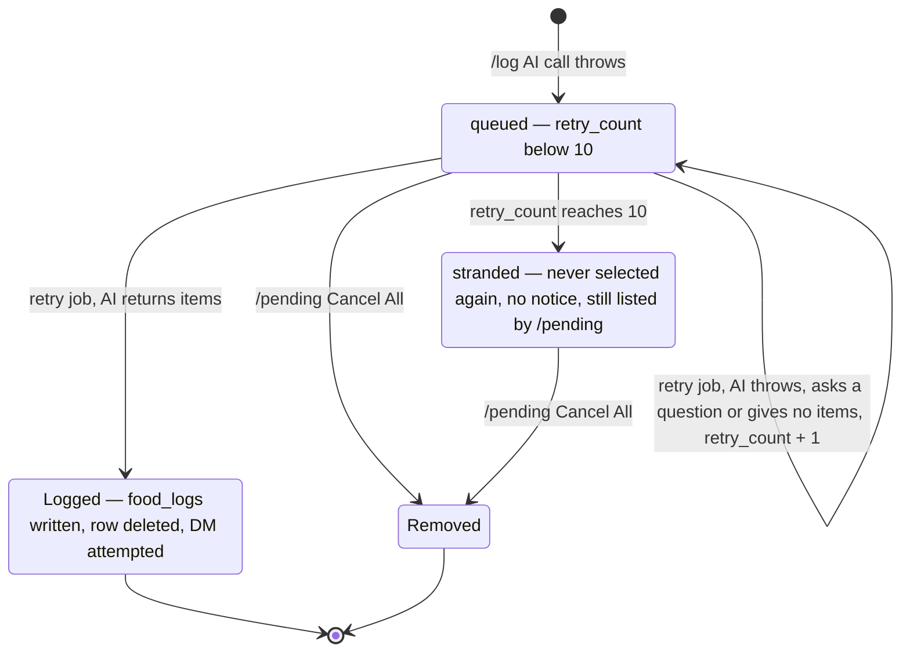
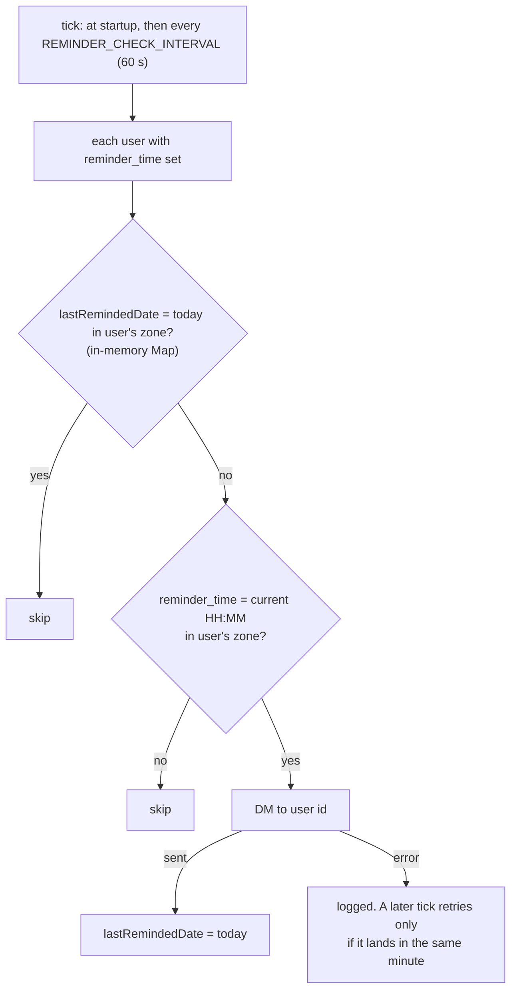
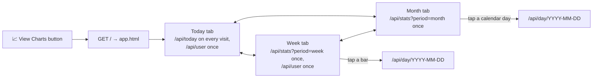

# User flows

Every user-facing flow in TeleCal, mapped from the code on `main` at `1c7c51f`. This is the input to the simplification pass in [#2](https://github.com/martin0x/TeleCal/issues/2): the diagrams show what the handlers do today, including the parts that look wrong. Those are collected under [Findings](#11-findings).

Issue #2 was written against `chore/sdk-and-model-refresh`. Since then, #3 added the `log:` and `del:` button callbacks, and `/usage` was added. Line numbers here are current.

- [1. How an update is routed](#1-how-an-update-is-routed)
- [2. Entry points](#2-entry-points)
- [3. `/log`](#3-log)
- [4. `/edit`](#4-edit)
- [5. `/delete`](#5-delete)
- [6. `/settings`](#6-settings)
- [7. `/pending` and parked entries](#7-pending-and-parked-entries)
- [8. Reminders](#8-reminders)
- [9. Mini App](#9-mini-app)
- [10. Exits, per flow](#10-exits-per-flow)
- [11. Findings](#11-findings)
- [12. Overlaps](#12-overlaps)
- [13. What the map says about the simplification](#13-what-the-map-says-about-the-simplification)

## 1. How an update is routed

Every update runs through the middleware chain in [`src/bot/index.ts`](../src/bot/index.ts). grammY runs handlers in registration order and stops at the first handler that doesn't call `next()`.

Code: allowlist [`allowlist.ts:7`](../src/bot/middleware/allowlist.ts#L7), upsert [`index.ts:47`](../src/bot/index.ts#L47), commands [`index.ts:54-81`](../src/bot/index.ts#L54-L81), callback router [`index.ts:84-99`](../src/bot/index.ts#L84-L99), text router [`index.ts:108-124`](../src/bot/index.ts#L108-L124). The last diamond (`conversation_state` row) is checked inside the log handler, [`log.ts:104`](../src/bot/commands/log.ts#L104), not in the router.

How the router behaves:

- **States stack.** Starting one flow never clears another flow's state, and nothing times out. A user can hold all four at once, and text always goes to the highest-priority one. Example: tap *Set Daily Goal*, walk away, later send `/log`. The bot replies "What did you eat?", then answers "chicken adobo" with "Please enter a number between 100 and 10000, or 'off' to clear."
- **Registered commands never reach the text router**, so they leave other flows' state alone. A flow's own command still resets its own state (§10). grammY matches the exact, case-sensitive name, with an optional `@` for this bot. Anything else starting with `/` arrives as plain text, including `/cancel`, `/Log` and `/log@OtherBot`. If the top-priority flow is `/edit`, `/delete` or `/settings`, its state is dropped without a reply. `/log` ignores such text and keeps its session.
- **State is keyed by Telegram user id, not chat.** A flow started in a group continues from the DM, and the other way round.
- **Group replies are labelled.** In a group or supergroup, every `smartReply` and `smartEdit` starts with a header line: the member's badge, then the first name in bold ("🔵 **Maria**"). The badge is the emoji they picked for that group with `/emoji`, looked up per update by middleware in [`index.ts`](../src/bot/index.ts) into `ctx.groupBadge`, or else a colour dot picked from the user id. Plain-text messages are escaped and sent as HTML so the header can be bold. A reply to a user's message also quotes that message (`reply_parameters`, `allow_sending_without_reply`); after a button press there is no user message, so nothing is quoted ([`smart-reply.ts`](../src/bot/utils/smart-reply.ts)). Private chats get the message unchanged.
- **Callbacks:** `log:` and `del:` carry the owner's id and refuse other pressers. `settings:` and `pending:` act on whoever pressed (see [F11](#f11)).

## 2. Entry points

### Commands

| Command | Handler | State it opens | Notes |
|---|---|---|---|
| `/start` | [`index.ts:54`](../src/bot/index.ts#L54) | — | Help text. Says `Type "cancel" to abort any active conversation` (see [F1](#f1)). |
| `/log [date] [food]` | [`createLogCommand`](../src/bot/commands/log.ts) | `conversation_state` row | `date`: `today`, `yesterday`, `YYYY-MM-DD`, `jan 31`, alone or leading the food (`/log yesterday: 2 eggs`). Arguments that aren't a date are food for today, estimated at once ([`parseLogArgs`](../src/bot/commands/log.ts)). |
| `/emoji [emoji\|reset]` | [`emoji.ts`](../src/bot/commands/emoji.ts) | `group_badges` row | Groups only; in a DM it explains. One emoji (skin tones, ZWJ sequences, flags, keycaps); refused if another member of the group has it. `reset`, `default`, `clear` or `off` go back to the colour dot. No argument shows the current badge. Keyed by chat id, so a group upgraded to a supergroup starts over. |
| `/edit`, `/edit N` | [`edit.ts:25`](../src/bot/commands/edit.ts#L25) | `editStates` | Today only. |
| `/delete`, `/delete N`, `/delete all` | [`delete.ts:70`](../src/bot/commands/delete.ts#L70) | `deleteStates` | Today only. |
| `/settings` | [`settings.ts:57`](../src/bot/commands/settings.ts#L57) | none until a button sets `pendingSettings` | Settings text and main keyboard. |
| `/pending` | [`pending.ts:26`](../src/bot/commands/pending.ts#L26) | — | Lists `pending_entries`, with *Cancel All* and *Retry Now*. |
| `/today` | [`today.ts:9`](../src/bot/commands/today.ts#L9) | — | Today's items and goal progress, with a *View Charts* button. |
| `/week`, `/month` | [`stats.ts:9`](../src/bot/commands/stats.ts#L9), [`:21`](../src/bot/commands/stats.ts#L21) | — | 7-day and 30-day summaries, with a *View Charts* button. |
| `/usage` | [`usage.ts:25`](../src/bot/commands/usage.ts#L25) | — | The caller's AI token usage over 30 days. |
| `/admin [add\|remove\|list\|usage]` | [`admin.ts:67`](../src/bot/commands/admin.ts#L67) | — | `ADMIN_USERS` only. |

### Inline keyboard callbacks

| Callback data | Sent by | Handler | Owner check | Effect |
|---|---|---|---|---|
| `settings:provider` | `/settings` main keyboard | [`settings.ts:91`](../src/bot/commands/settings.ts#L91) | no | Swaps in the provider picker |
| `settings:provider:<name>` | provider picker | [`settings.ts:152`](../src/bot/commands/settings.ts#L152) | no | Saves the provider, back to main |
| `settings:goal`, `:reminder`, `:timezone` | main keyboard | [`settings.ts:105-136`](../src/bot/commands/settings.ts#L105-L136) | no | Sets `pendingSettings` for the presser. Edits the message to a prompt, which drops the keyboard |
| `settings:back` | provider picker | [`settings.ts:138`](../src/bot/commands/settings.ts#L138) | no | Back to the main keyboard |
| `settings:close` | main keyboard | [`settings.ts:146`](../src/bot/commands/settings.ts#L146) | no | Deletes the message |
| `pending:cancel_all` | `/pending` | [`pending.ts:62`](../src/bot/commands/pending.ts#L62) | no | Deletes all of the presser's `pending_entries` |
| `pending:retry` | `/pending` | [`pending.ts:69`](../src/bot/commands/pending.ts#L69) | no | Shows a toast and nothing else ([F7](#f7)) |
| `log:ok\|chg\|cxl:<owner>:<token>` | `/log` confirmation | [`log.ts:160`](../src/bot/commands/log.ts#L160) | yes | Log, Change or Cancel ([§3](#3-log)) |
| `del:one:<owner>:<itemId>` | `/delete` single prompt | [`delete.ts:249`](../src/bot/commands/delete.ts#L249) | yes | Deletes one item |
| `del:all:<owner>:<date>:<token>` | `/delete` all prompt | [`delete.ts:249`](../src/bot/commands/delete.ts#L249) | yes | Deletes the day |
| `del:cxl:<owner>` | both `/delete` prompts | [`delete.ts:249`](../src/bot/commands/delete.ts#L249) | yes | Cancels |

Formats: [`callback-data.ts`](../src/bot/utils/callback-data.ts). The `<token>` in `log:` and `del:all:` is a fingerprint of what the message showed, so a stale button is refused instead of acting on different data.

### Free text

There are four text handlers, picked by the router in §1: settings, delete, edit and log. With no active state, text is ignored without a reply.

### Mini App

It opens from the **📈 View Charts** `web_app` button on `/today`, `/week` and `/month` replies in private chats. In groups those commands post a hint instead and try to DM the button, which fails silently if the user never started the bot ([`today.ts:42-55`](../src/bot/commands/today.ts#L42-L55)). Routes are listed in [§9](#9-mini-app).

### Background jobs

Both jobs start in `bot.start({ onStart })` ([`src/index.ts:24`](../src/index.ts#L24)) and message users unprompted.

| Job | Runs | Sends |
|---|---|---|
| [`reminders.ts`](../src/jobs/reminders.ts) | at startup, then every `REMINDER_CHECK_INTERVAL` (60 s) | A DM at the user's `reminder_time` ([§8](#8-reminders)) |
| [`retry-pending.ts`](../src/jobs/retry-pending.ts) | every `PENDING_RETRY_INTERVAL` (5 min). The first run comes one interval after startup | A DM when a parked `/log` entry gets logged ([§7](#7-pending-and-parked-entries)) |

## 3. `/log`

State lives in `conversation_state`, one row per user ([`schema.sql:43`](../src/db/schema.sql#L43)), so a session survives a restart. The state machine is [`LogFlow`](../src/bot/conversations/log-flow.ts). The text handler in [`log.ts:93`](../src/bot/commands/log.ts#L93) screens input before it gets there.

**Text screening, in order** ([`log.ts:98-131`](../src/bot/commands/log.ts#L98-L131), then [`log-flow.ts:117-159`](../src/bot/conversations/log-flow.ts#L117-L159)):

1. No row: ignored, no reply.
2. Starts with `/`: ignored, and the session is kept.
3. `continue`: re-sends the prompt for the current state ([`getStatusMessage`](../src/bot/conversations/log-flow.ts#L429)). In `clarifying` it sends a generic "Could you provide more details?", not the AI's actual question. In `confirming` it sends the confirmation again with fresh buttons.
4. `new`: deletes the row and starts `awaiting_input` **for today** ([F3](#f3)).
5. `cancel`: deletes the row. "Cancelled. Use /log when you're ready to log food."
6. Otherwise the text is handled by the current state.

Steps 3–5 match the whole message, case-insensitive, in any state, not only after the "continue or new" question. A food description or clarification answer that is exactly `new` restarts the session.

**`/log food`** ([`startWithFood`](../src/bot/conversations/log-flow.ts)) skips "What did you eat?": it opens an `awaiting_input` row and runs the food through `processInput`, so it can clarify, confirm or park like typed food. An existing row is replaced, and the reply starts "Replaced your unfinished log for *old date*."

**`/log` without food while a row exists** ([`log-flow.ts:77-84`](../src/bot/conversations/log-flow.ts#L77-L84)) changes nothing. It replies "You already have an active log session for *old date*. Reply "continue" to resume it, or "new" to start fresh for *requested date*."

**AI calls.**

- `awaiting_input` calls the AI with `callType: "estimate"` and no context, so the cache can answer.
- `clarifying` calls with `callType: "clarify"` and the original input plus earlier answers as context, which bypasses the cache.
- A thrown error parks the entry ([`handleAIError`](../src/bot/conversations/log-flow.ts#L389)). The text saved is the input. In `clarifying` it is `"<previous message> - <this answer>"`. The previous message is the original description on the first answer and the last answer after that, so from the second round on the original description is lost.
- "AI returns a result" means `needsClarification: false`. The item list isn't checked, so an empty list still moves to `confirming` ([F5](#f5)).

**Confirmation.** The message reads "Here's what I'll log for *date*:", then the item summary, then the buttons **✅ Log N cal** / **✏️ Change** / **✖️ Cancel**. Typed replies and button presses share `commitPending` and `backToInput` ([`log-flow.ts:310-325`](../src/bot/conversations/log-flow.ts#L310-L325)), but they reply differently:

| Choice | Typed | Button (edits the message in place) |
|---|---|---|
| Log | `yes` / `y`: "Logged 450 calories for 2026-09-27." | "✅ Logged to Sun, Sep 27:" plus the summary, toast "Logged ✅" |
| Change | `no` / `n`: "Okay, let's try again. What did you eat?" | "✏️ Not logged — changing:" above the struck-through summary, then the same follow-up |
| Cancel | `cancel`: "Cancelled. Use /log when you're ready to log food." | "✖️ Cancelled — not logged:" above the struck-through summary, toast "Cancelled" |
| other | 'Tap a button above, or reply "yes" / "no".' | — |

**Button press** ([`log.ts:160-202`](../src/bot/commands/log.ts#L160-L202), [`resolveConfirmation`](../src/bot/conversations/log-flow.ts#L263)):

## 4. `/edit`

State is `editStates`, a module-level `Map` in [`edit.ts:17`](../src/bot/commands/edit.ts#L17), lost on restart. `pendingAction` is `"select"` or `"edit"`. There is no confirmation step: a valid reply changes the item right away.

- `/edit` with no items today replies "No entries for Sun, Sep 27." and opens no state.
- Only today's items (user timezone) can be edited. The list is copied into the `Map` when `/edit` runs.
- A re-estimate uses `callType: "edit"` and keeps **only the first item** the AI returns, replacing the description, calories and emoji ([`edit.ts:162-168`](../src/bot/commands/edit.ts#L162-L168)).
- If the AI fails, the entry is not parked. The reply is "Couldn't reach AI to estimate. Try typing a number instead, or "cancel" to abort." and the state stays `edit`.
- Numbers are read with `parseInt`, so `2 eggs` sets calories to 2 ([F9](#f9)).
- The update targets the item id copied into the `Map` and doesn't check it still exists. If the item was deleted in the meantime, the update matches no row but the bot still replies "Updated: …" ([F10](#f10)).
- Running `/edit` again overwrites the entry, but only if today has items. Otherwise it replies "No entries…" and the old entry stays.

## 5. `/delete`

State is `deleteStates`, a module-level `Map` in [`delete.ts:21`](../src/bot/commands/delete.ts#L21), lost on restart. `pendingAction` is `"select"`, `"confirm_single"` or `"confirm_all"`. Both confirm prompts carry buttons, and the buttons don't read the `Map` at all.

- Typed `yes` trusts the copy in the `Map`. Single deletes the copied item id without checking it still exists. All runs `deleteAllForDate`, which removes whatever is in the database for that day ([F10](#f10)).
- The confirm fallback is 'Tap a button above, or reply "yes" / "cancel".' `no` is not recognised here, while `/log` treats `no` as Change.
- Running `/delete` again overwrites the entry, but only if today has items. Otherwise it replies "No entries…" and the old entry stays.

**Button press** ([`delete.ts:217-287`](../src/bot/commands/delete.ts#L217-L287)). The press is checked against the database, not the `Map`, so buttons keep working after a restart:

## 6. `/settings`

Two kinds of state are involved. The keyboards live on the message and are not stored anywhere. `pendingSettings` is a module-level `Map` in [`settings.ts:9`](../src/bot/commands/settings.ts#L9), set only by a button press and lost on restart.

- The text handler is [`settings.ts:173-248`](../src/bot/commands/settings.ts#L173-L248). It has no `cancel` branch, so `cancel` fails validation as a goal, time or timezone and the prompt repeats ([F1](#f1)).
- The Set Goal, Reminder and Timezone buttons edit the message into a plain prompt, which removes the keyboard, so there is no button to back out either.
- The buttons act on the presser, not the person who ran `/settings` ([F11](#f11)).
- "Please use /start first." ([`settings.ts:64`](../src/bot/commands/settings.ts#L64), [`:84`](../src/bot/commands/settings.ts#L84)) can't happen, because the middleware upserts every sender first.

## 7. `/pending` and parked entries

A `/log` whose AI call throws writes a `pending_entries` row and ends the session. The retry job and `/pending` are the only things that touch the row after that.

**Retry job** ([`retry-pending.ts:15-87`](../src/jobs/retry-pending.ts#L15-L87)):

- Each run takes the 5 oldest rows with `retry_count < 10` ([`pending.ts:41-49`](../src/db/repositories/pending.ts#L41-L49)).
- It calls the AI with the user's current provider and `callType: "retry"`, so the cache can answer.
- On success it writes `food_logs`, deletes the row, and DMs "✅ Processed your saved entry — logged to Sun, Sep 27:" with the summary. The DM goes to the user id, not the chat the entry came from. If the DM fails, the entry is still logged, but the user is never told.
- A clarification request or empty result counts as a failure.
- The give-up branch at [`retry-pending.ts:27-41`](../src/jobs/retry-pending.ts#L27-L41) (delete the row, DM "❌ Couldn't process your entry…") can never run ([F6](#f6)).

**`/pending`** ([`pending.ts`](../src/bot/commands/pending.ts)):

- With nothing parked it replies "No pending entries. All caught up!"
- Otherwise it replies "📋 Pending entries:" and lists each row as `N. "text"` with `Submitted: … → will log to …` on the next line. The message has **Cancel All** / **Retry Now** buttons.
- *Cancel All* deletes the presser's rows and edits the message to "Cancelled N pending entries."
- *Retry Now* only shows the toast "Entries will be retried soon" and triggers nothing ([F7](#f7)).

## 8. Reminders

[`reminders.ts:55-101`](../src/jobs/reminders.ts#L55-L101). There are four message variants: nothing logged, under goal, goal reached, and no goal set. "Nothing logged" means no `food_logs` rows for the day. Deleting items one by one leaves those rows in place, so a day emptied that way gets a check-in showing 0 cal instead. `@username` goes first when `reminder_mention` is on and the user has a username. `reminder_mention` defaults to on and has no setting in `/settings`. The `lastRemindedDate` `Map` is in memory, so a restart inside the reminder minute sends the reminder again, because the job also runs at startup.

## 9. Mini App

It shares the data with the bot but none of the conversation machinery.

| Route | Auth | Returns |
|---|---|---|
| `/`, `/index.html` | none | [`app.html`](../src/web/views/app.html) |
| `/api/user` | initData | `daily_goal`, `username` |
| `/api/today` | initData | today's items and total, in the user's timezone |
| `/api/stats?period=week\|month` | initData | daily totals with missing days filled as 0. No `period` means week. Any other value gets a 400 |
| `/api/day/YYYY-MM-DD` | initData | that day's items and total |
| other `/api/*` | initData | 401 without valid initData, otherwise a JSON 404 |
| anything else | — | 404 |

- Every `/api/*` call needs `Authorization: tg-init-data <initData>`, checked by HMAC in [`auth.ts:12`](../src/web/auth.ts#L12). `auth_date` must be under 5 minutes old ([`auth.ts:36`](../src/web/auth.ts#L36)).
- The API does not check `allowed_users`.
- Week, month and user data are fetched once and cached in the page. The Today tab fetches `/api/today` again on every click.
- A failed tab load is only logged to the console ([`app.html:645`](../src/web/views/app.html#L645)).
- These points combine into [F12](#f12).
- The Month calendar draws only the calendar month of the range's first day ([F14](#f14)).

## 10. Exits, per flow

| Exit | `/log` | `/edit` | `/delete` | `/settings` text step |
|---|---|---|---|---|
| Completes | typed `yes`/`y` or ✅ button | a number from 1 to 9999, or a successful re-estimate | typed `yes`/`y` or 🗑 button | a valid value. Goal also takes `off` or `clear`, and reminder `off` or `disable`, which clear the setting. Timezone can't be cleared |
| Typed `cancel` | ✓ any state | ✓ | ✓ | ✗ fails validation and re-prompts |
| Cancel button | ✖️, on the confirmation only | — | ✖️, on both confirm prompts | — (Close and Back don't clear it) |
| Typed `no` | = Change in `confirming`. Otherwise sent to the AI | not special | not recognised, fallback prompt | invalid |
| Unregistered `/command` | ignored, session kept | state dropped, no reply | state dropped, no reply | state dropped, no reply |
| Registered command | runs, session kept | runs, state kept | runs, state kept | runs, state kept |
| Own command again | asks `continue` or `new` | overwritten if today has items, else kept | overwritten if today has items, else kept | menu shown, state kept |
| Timeout | none | none | none | none |
| Restart | survives | lost. The next reply falls through to the next handler, or is ignored | lost. Buttons still work | lost. The prompt stays on screen, and the reply falls through |
| AI failure | parked in `pending_entries`, session ends | stays in `edit`, suggests typing a number | — | — |

Typed input reaches only the highest-priority flow the user is in, and that includes `cancel` and unregistered `/commands`. With stacked states it takes one `cancel` per flow. While `pendingSettings` is set, `cancel` does nothing at all: settings always comes first and has no `cancel` branch, so only an unregistered `/command` clears it.

## 11. Findings

Places where the code contradicts a user-facing claim, or where a path ends somewhere it probably shouldn't.

**F1. `cancel` is not universal.** `/start` promises it works for "any active conversation" ([`index.ts:68`](../src/bot/index.ts#L68)). The `/settings` text step has no `cancel` branch, and with stacked states `cancel` exits only the top flow.

**F2. Stale state shadows newer flows.** No flow clears another's state, and none time out, so an abandoned higher-priority state captures text meant for a newer flow (§1). `/settings` is the worst case: no `cancel`, and neither Close, Back nor re-running `/settings` clears `pendingSettings`.

**F3. `new` ignores the date the prompt named.** After `/log yesterday` with a session open, the bot says "new to start fresh for *yesterday's date*", but `new` starts a session for today ([`log.ts:124`](../src/bot/commands/log.ts#L124)). The requested date is never stored.

**F4. `/log` date parsing is loose.**

- An unparseable date is read as food for today: `/log tomorrow` estimates "tomorrow". A food that starts with a month and a number is read as a date: `/log may 2 eggs` logs "eggs" to May 2. The confirmation names the date, so the user can tap Change.
- `YYYY-MM-DD` isn't validated ([`log.ts:38-41`](../src/bot/commands/log.ts#L38-L41)), so future dates and `2026-02-31` are stored as typed.
- For `jan 31`-style dates, a day past the month's end rolls over: `feb 30` becomes March 2 ([`log.ts:55`](../src/bot/commands/log.ts#L55), [`:62`](../src/bot/commands/log.ts#L62)).
- Whether such a date is in the future is judged by the server clock, not the user's timezone ([`log.ts:51-59`](../src/bot/commands/log.ts#L51-L59)).

**F5. A result with no items traps the session in `confirming`.** [`processEstimationResult`](../src/bot/conversations/log-flow.ts#L345) doesn't check `items.length`, and all three providers default a missing list to `[]`. The confirmation then shows "✅ Log 0 cal".

- Pressing any of the three buttons answers "no longer pending" and removes the keyboard, because `resolveConfirmation` treats empty items as stale before it looks at the choice ([`log-flow.ts:280`](../src/bot/conversations/log-flow.ts#L280)).
- Typing `yes` answers "…Please start over with /log." ([`log-flow.ts:228`](../src/bot/conversations/log-flow.ts#L228)), but `/log` then says a session is already active.
- `continue` answers "Something went wrong. Please start over with /log" ([`log-flow.ts:452-456`](../src/bot/conversations/log-flow.ts#L452-L456)).
- The only ways out are typing `cancel`, `new` or `no`.
- The empty result is cached, because any result without `needsClarification` is cached ([`service.ts:87-89`](../src/ai/service.ts#L87-L89)). Sending the same text again returns the same empty list without calling the AI.

**F6. The retry give-up path is dead code.** `getForRetry` selects only `retry_count < 10` ([`pending.ts:44`](../src/db/repositories/pending.ts#L44)), so the job's `retry_count >= MAX_RETRIES` branch ([`retry-pending.ts:27`](../src/jobs/retry-pending.ts#L27)) never runs. After 10 failures an entry is never retried, never removed, and the user is never told. `/pending` keeps listing it as "will log to …".

**F7. *Retry Now* doesn't retry.** It only shows a toast ([`pending.ts:69-74`](../src/bot/commands/pending.ts#L69-L74)).

**F8. Timeout scaffolding exists but is never called.** `config.timing.conversationTimeout` (`CONVERSATION_TIMEOUT`, default 10 min, [`config.ts:48`](../src/config.ts#L48)) and `ConversationsRepository.deleteStale` ([`conversations.ts:75`](../src/db/repositories/conversations.ts#L75)) have no callers. Neither do the exported `clearEditState` ([`edit.ts:184`](../src/bot/commands/edit.ts#L184)) and `clearPendingSettings` ([`settings.ts:291`](../src/bot/commands/settings.ts#L291)).

**F9. The number parsing is lenient.** Both pickers and the `/edit` calorie step use `parseInt`, so `1st` picks item 1. At the edit step, `2 eggs` sets calories to 2 instead of re-estimating ([`edit.ts:134-135`](../src/bot/commands/edit.ts#L134-L135)), while `0` or `12000` go to the AI as a food description.

**F10. Typed replies trust the in-memory copy, buttons check the database.**

- A typed `yes` on "all" runs `deleteAllForDate` on whatever the database holds, but reports the count from the copy ([`delete.ts:193-197`](../src/bot/commands/delete.ts#L193-L197)). The button refuses if the set changed ([`delete.ts:233`](../src/bot/commands/delete.ts#L233)).
- A typed single `yes` deletes the copied id and reports success without checking the item still exists.
- `/edit` updates the copied id the same way and replies "Updated: …" even when no row matched ([`edit.ts:136-140`](../src/bot/commands/edit.ts#L136-L140), [`:164-172`](../src/bot/commands/edit.ts#L164-L172)). One way to reach it: `/edit`, then `/delete all` and `yes`, then `/edit` again (which keeps the old entry, §10), then a number.

**F11. `/settings` and `/pending` buttons act on the presser.** In a group, someone tapping another user's *Set Daily Goal* turns that user's settings message into a prompt and arms the tapper's own `pendingSettings`. Tapping another user's *Cancel All* cancels the tapper's own entries and overwrites that user's list with the tapper's count. The `log:` and `del:` buttons refuse non-owners.

**F12. Mini App sessions die after 5 minutes.** Every request sends `tg.initData` ([`app.html:310`](../src/web/views/app.html#L310)). Telegram fixes that value when the Mini App opens, so its `auth_date` never refreshes. The server rejects an `auth_date` older than 5 minutes, so every API call after that returns 401. Tab loads then fail with no visible message, and day views show "Failed to load".

**F13. Some button presses are never answered**, which leaves the client spinner running:

- callback data with no matching prefix ([`index.ts:98`](../src/bot/index.ts#L98)), or an unknown `settings:` or `pending:` action;
- presses from users not on the allowlist, who get the invite-only text posted in the chat instead;
- `settings:` and `pending:` presses whose message edit fails. Those handlers answer only after `editMessageText` or `deleteMessage` succeeds, so a double-tapped *Set Daily Goal* ("message is not modified") or a second *Close* throws first ([`settings.ts:98-101`](../src/bot/commands/settings.ts#L98-L101), [`pending.ts:64-65`](../src/bot/commands/pending.ts#L64-L65)).

**F14. The Month calendar shows the wrong month.** `createCalendar` draws only the calendar month of the range's first day ([`app.html:519-545`](../src/web/views/app.html#L519-L545)). The 30-day range on Sep 27 starts Aug 29, so the calendar shows August, and Sep 1–27 can't be tapped.

## 12. Overlaps

Places where two flows ask the user the same kind of question with different code and wording.

**Pick an item by number: `/edit` and `/delete`.**

- Both are today-only, copy the list into their own `Map`, use the same `/cmd N` range check, and print the same `N. emoji description — cal cal` list under the same "*date* entries:" header.
- Each file has its own `formatItemsList` ([`edit.ts:19`](../src/bot/commands/edit.ts#L19), [`delete.ts:29`](../src/bot/commands/delete.ts#L29)).
- The prompts differ: 'Which item to edit? (enter number or "cancel")', and a three-bullet "What to delete?" that also offers `all`.
- The re-prompts differ: 'Please enter a number (1-N) or "cancel".' and 'Please enter a number (1-N), "all", or "cancel".'

**Confirm yes/no: `/log` and `/delete`.**

- Both put the owner id in the button data and show the same "expired" and "Only the person who started this…" toasts. A `shortHash` token is carried by all three `log:` buttons, but only by `del:all`: `del:one` carries the item id, and `del:cxl` carries no payload.
- The typed words differ:

  | | `/log` | `/delete` |
  |---|---|---|
  | Accepts | `yes`/`y`, `no`/`n`, `cancel` | `yes`/`y`, `cancel` |
  | Fallback | 'Tap a button above, or reply "yes" / "no".' | 'Tap a button above, or reply "yes" / "cancel".' |
  | Typed `yes` | same code path as the button | skips the database check the button makes ([F10](#f10)) |

- `/edit` and `/settings` apply changes with no confirmation at all.

**Free-text correction.** Three paths send new text to the AI, and each handles "needs clarification" differently:

| Path | On a clarification request |
|---|---|
| `/log` clarifying | loops, carrying context |
| `/log` Change | enters `clarifying` like a fresh `/log`, without the rejected estimate as context |
| `/edit` re-estimate | "Couldn't estimate…" and a re-prompt. On success it keeps only the first item |

The retry job is a fourth caller, and it counts a clarification request as a failure.

**Cancel.** There are four behaviours:

- `/log` handles it inside `LogFlow.processInput`.
- `/edit` and `/delete` each have their own "Cancelled." branch.
- `/settings` has none.
- The button cancels also differ: "✖️ Cancelled — not logged:" with the struck summary, against "✖️ Cancelled — nothing deleted."

**Slash-command escape.** `/edit`, `/delete` and `/settings` each implement "text starts with `/` → drop state". `/log` does the opposite and keeps its session.

**View Charts button.** The same inline keyboard and the same group-DM fallback are pasted four times across [`today.ts`](../src/bot/commands/today.ts) and [`stats.ts`](../src/bot/commands/stats.ts).

## 13. What the map says about the simplification

The issue proposed three changes. The map bears on each:

1. **One state store.** Supported.
   - `/edit`, `/delete` and `/settings` lose state on restart, and the next reply falls through to whichever handler is next.
   - `conversation_state` has one row per user (`telegram_id` is the primary key). Moving every flow into it would allow only one active flow per user, which ends stacking and removes [F2](#f2) instead of patching it.
   - The table's columns are `/log`-shaped (`pending_food`, `pending_items`, `context`), so it would need a flow name and a generic payload.
2. **One router.** Supported. The priority chain matters only because states can stack. With one active flow per user, routing becomes a lookup on the flow name.
3. **Shared conversation primitives.** Supported for all three candidates: the number picker (`/edit` and `/delete` are near-copies), yes/no confirm (`/log` and `/delete` share the button scheme but not the typed words or checks) and cancel (four behaviours).

On the open questions:

- **`/edit` and `/delete` as one flow.** They share the today-only fetch, the list format and the `/cmd N` range check. The prompts, the re-prompts and `/delete`'s `all` option differ. After the pick, `/edit` takes free text or an AI estimate with no confirmation, and `/delete` confirms with buttons.
- **Restart survival for `/settings`.** Today a restart leaves the prompt on screen while the reply falls through or is silently dropped. That is neither a clean loss nor a resume.
- **Timeouts.** The config value and the repository method already exist ([F8](#f8)). Only the job that calls them is missing.
- **The Mini App.** It shares only data and the entry button. Its auth is `initData`, not the allowlist, and it has no conversation state. It belongs in the entry-point table and nowhere else in this refactor.
